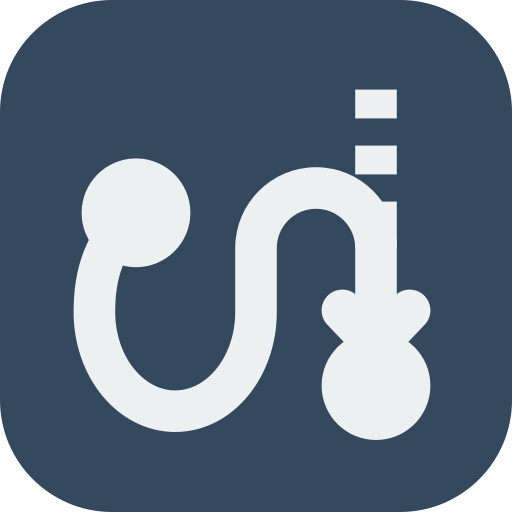

<p align="center">
  
</p>

# Gati-chitra

Gati-chitra is an interactive Mermaid flowchart editor that animates edges in real time and runs entirely in your web browser. You can type Mermaid syntax, drag nodes to adjust the layout, and export the diagram as a PNG, static SVG, animated GIF, or video without sending any data to a remote server.

## Run locally

Install dependencies and start the local development server:

```bash
npm install
npm run dev
```

Run the automated test suites:

```bash
npm run lint        # Check code with oxlint
npm test            # Run unit tests
npm run build       # Type check and bundle for production
npm run check:dist  # Verify build integrity, assets, and bundle budget
npm run test:e2e     # Run end-to-end browser tests
```

## What's new in v0.4.0

- Code editor: CodeMirror 6 text editor with syntax highlighting, line numbers, and gutter lint markers on syntax errors.
- Toolbar and Help: Toolbar grouped into File, Edit, and View sections, plus a Help dialog (`?`) listing all keyboard shortcuts.
- Resizable panels: Draggable and keyboard-adjustable panel splitter that remembers width across sessions.
- Canvas keyboard controls: Select nodes with arrow keys, cycle connected arrows with `[` and `]`, nudge node positions with Shift+Arrow, rename with Enter, and connect nodes via the properties panel.
- Clipboard export: Copy PNG images and SVG markup directly to your clipboard.
- Bundle budget: Initial JS stays under 150 KB gzip.

## What's new in v0.3.0

- Extended Mermaid syntax: 10 additional node shapes, 5 new arrow styles, variable link lengths, and per-edge animation controls.
- Text formatting: bold and italic markdown labels, HTML entity codes, and diagram titles in frontmatter.
- Subgraphs: layout direction per subgraph, and arrows connecting directly to subgraphs.
- Accessibility and links: accessible diagram descriptions, and clickable links in exported SVG diagrams.
- Syntax preservation: visual edits preserve property blocks, edge lengths, and multi-statement lines.

## Supported Mermaid syntax

Gati-chitra supports standard Mermaid flowchart declarations:

- Direction headers: `flowchart TD`, `flowchart LR`, `flowchart BT`, `flowchart RL`, and `graph` equivalents.
- Frontmatter titles:
  ```mermaid
  ---
  title: Network overview
  ---
  ```
- Multiple statements per line separated by semicolons: `A --> B; B --> C`.
- Identifiers: letters, digits, underscores, hyphens, and Unicode characters (`web-server`, `node_1`, `데이터`).
- Node bracket shapes:
  - Rectangle: `A[text]`
  - Rounded rectangle: `B(text)`
  - Stadium: `C([text])`
  - Circle: `D((text))`
  - Double circle: `E(((text)))`
  - Diamond: `F{text}`
  - Hexagon: `G{{text}}`
  - Parallelogram: `H[/text/]`
  - Parallelogram reversed: `I[\text\]`
  - Trapezoid: `J[/text\]`
  - Trapezoid reversed: `K[\text/]`
  - Cylinder: `L[(text)]`
  - Subroutine: `M[[text]]`
  - Flag or asymmetric: `N>text]`
- Property syntax `@{ }` node shapes:
  - Document: `A@{ shape: doc, label: "Report" }`
  - All 20 short shape names: `rect`, `rounded`, `stadium`, `circle`, `diam`, `hex`, `lean-r`, `lean-l`, `cyl`, `fr-rect`, `trap-b`, `trap-t`, `dbl-circ`, `odd`, `doc`, `sm-circ`, `f-circ`, `fr-circ`, `fork`, and `text`.
- Arrow connections and lengths:
  - Solid arrows: `A --> B` (longer: `A ---> B`)
  - Open lines: `A --- B` (longer: `A ---- B`)
  - Dotted arrows: `A -.-> B` (longer: `A -..-> B`)
  - Dotted lines: `A -.- B` (longer: `A -..- B`)
  - Thick arrows: `A ==> B` (longer: `A ===> B`)
  - Thick lines: `A === B` (longer: `A ==== B`)
  - Bidirectional arrows: `A <--> B`, `A <-.-> B`, `A <==> B`
  - Circle and cross ends: `A --o B`, `A --x B`
  - Two-ended markers: `A o--o B`, `A x--x B`
  - Invisible links for spacing: `A ~~~ B`
- Edge labels:
  - Pipe labels: `A -->|label| B` or `A -->|"quoted label"| B`
  - Inline labels: `A -- label --> B`, `A == label ==> B`, `A -. label .-> B`
- Edge identifiers and animation overrides:
  - Edge identifier: `A e1@--> B`
  - Animation properties: `e1@{ animate: true, animation: fast }` (or `animation: slow`)
- Markdown formatting in labels:
  - Backtick strings support bold and italic formatting: `A["`**Bold** and *italic*`"]`
  - Explicit line breaks with `<br/>` or `<br>`.
- Entity codes:
  - Code points such as `#9829;` (heart), `#35;` (`#`), and named entities `#amp;`, `#lt;`, `#gt;`, `#quot;`, `#apos;`, and `#nbsp;`.
- Subgraphs:
  - Subgraph containers: `subgraph S [Title] ... end`
  - Direction within a subgraph: `direction LR`
  - Arrow connections to subgraphs: `A --> S`
- Interactive links on nodes:
  - `click A "https://example.com" "Tooltip" _blank`
- Accessibility annotations:
  - `accTitle: Title of the diagram`
  - `accDescr: Short description of the diagram`
  - Multi-line descriptions: `accDescr { ... }`
- Styling:
  - Default class: `classDef default fill:#f9f,stroke:#333`
  - Named classes: `classDef custom fill:#f9f,stroke:#333`
  - Applying classes: `class A custom` or `A:::custom`
  - Inline node styles: `style A fill:#ffd,stroke:#333`
  - Link styles: `linkStyle 0 stroke:#333,stroke-width:2px` or `linkStyle default stroke:#333`
- Comments:
  - Lines beginning with `%%`.

Lines with syntax that Gati-chitra does not understand are preserved in the text editor during graphical edits.

## Not supported

- Icons and images (`icon:`, `img:`)
- JavaScript click callbacks (`click A callbackName`)
- The `curve:` edge interpolation property
- Class-based edge animation
- Diagram types other than flowcharts (such as sequence, state, or class diagrams)

## Keyboard shortcuts

The table below lists the available keyboard shortcuts:

| Shortcut | Action |
| --- | --- |
| `Ctrl+Z` / `Cmd+Z` | Undo |
| `Ctrl+Y` / `Cmd+Shift+Z` | Redo |
| `Ctrl+0` / `Cmd+0` | Fit diagram to view |
| `+` / `=` | Zoom in |
| `-` | Zoom out |
| `P` | Toggle present mode |
| `K` | Pause or resume animation |
| `Delete` / `Backspace` | Delete selected node or edge |
| `Enter` | Rename selected node |
| `Escape` | Deselect or exit |
| `?` | Show help and shortcuts |
| `Drag canvas` | Pan the diagram view |
| `Arrow keys in present mode` | Next or previous present step |
| `Arrow keys on splitter` | Resize panels |
| `Arrow keys on canvas` | Select node in direction |
| `[` / `]` on canvas | Cycle arrows of selected node |
| `Shift+Arrow on canvas` | Nudge selected node position |

Hold `Space` while dragging to pan the canvas. Global keyboard shortcuts do not trigger while typing in text inputs or the code editor, except for `Escape`.

## Limits

Gati-chitra sets limits to ensure dependable browser performance:

- Maximum source text length: 20,000 characters
- Maximum nodes: 300
- Maximum edges: 600
- Zoom range: 0.1x to 4x
- Maximum export side length: 8,192 pixels
- Maximum PNG export area: 40,000,000 pixels
- Maximum GIF and video frame area: 2,073,600 pixels
- Export frame rates: 10 to 25 fps
- Export loop counts: 1 to 5 loops

## Saving

You can export diagrams in multiple formats:

- **PNG**: Bitmap raster export with 1x, 2x, or 3x scaling and optional transparent background.
- **SVG**: Standalone static vector graphic with inline font and geometry metadata.
- **GIF**: Animated GIF rendered with optimized global palette quantization.
- **MP4 / WebM**: Hardware-accelerated video using the WebCodecs API, with automatic fallback to GIF when video encoding is unavailable.

You can also copy diagrams directly to your clipboard from the export dialog:

- **Copy PNG**: Copies the raster diagram to the system clipboard as an image.
- **Copy SVG**: Copies the SVG markup to the system clipboard as text.

Node coordinates repositioned by dragging are saved directly into the Mermaid source using `%% studio:pos <id> <x> <y>` comment annotations. Other Mermaid renderers safely ignore these comment lines.

## Privacy

Gati-chitra processes all diagrams locally in your browser. It does not use server endpoints, cookies, analytics, or third-party tracking. Share links encode the full diagram text directly inside the URL hash fragment (`#v1=...`), which web browsers do not transmit to web servers.

## Branding

The site branding includes:

- The logo and favicon are defined in `public/favicon.svg`.
- The site name, owner metadata, and external navigation links are defined in `BRAND` in `src/core/constants.ts` and in `index.html`.
- Theme tokens in `src/app/tokens.css` match the colour system of the author's Diff Checker site.
- The UI font is Lato, bundled locally via `@fontsource/lato`.

## Working with AI agents

Repository instructions for AI coding assistants are maintained in `AGENTS.md`, `CLAUDE.md`, and `GEMINI.md`. These files specify installation and configuration for the `superpowers` development skills and the `humanizer` prose editing skill.

## Known limitations

- Subgraphs and node groups are edited directly in the Mermaid text rather than on the interactive canvas.
- Real line breaks in markdown labels are only supported within a single source line (or with `<br/>`).
- Only flowchart diagrams are supported.
